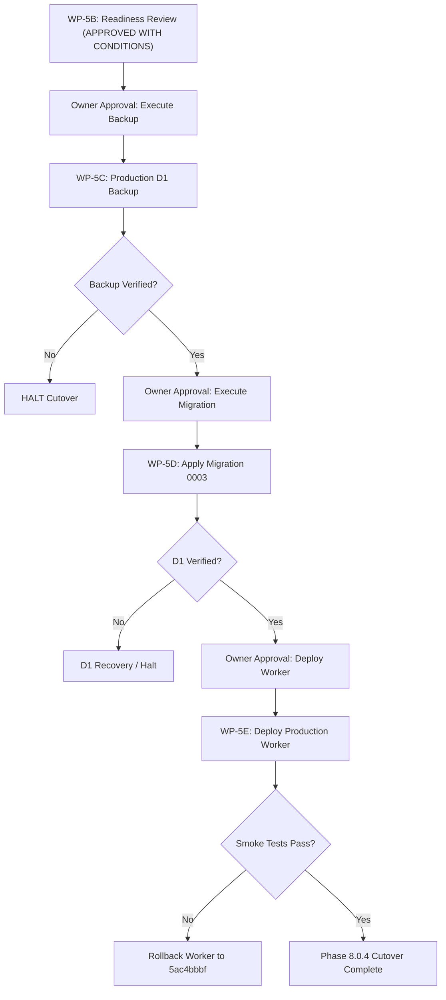

# Studio HQ — Phase 8.0.4 WP-5B Production Migration Preparation & Backup Readiness Review

**Document Date:** 22 November 2026  
**Auditor / Maintainer:** Senior Technical Lead and Documentation Maintainer  
**Repository:** `jawedimtiaz/jawed-website-ai-studio-lab`  
**Candidate Main Commit:** [`7dd22a5c4080faa67901b2f024beee383e538639`](https://github.com/jawedimtiaz/jawed-website-ai-studio-lab/commit/7dd22a5c4080faa67901b2f024beee383e538639)  
**Production Worker:** `jawed-website-ai-studio-lab` (Target URL: `https://lab.jawed.co.in/`)  
**Production Active Version ID:** `5ac4bbbf-69cf-436d-bf9d-9670e4478d66` (Source commit: `7069c338`)  
**Production D1:** `jawed-studio-hq` (`d9ec83ea-7114-4179-af8e-a22ba5494508`)  
**Preview Worker:** `jawed-website-ai-studio-lab-preview` (Version ID: `a50fd458-3cb8-4f4f-98eb-ead5fd19f0db`)  
**Preview D1:** `jawed-studio-hq-preview` (`623a828d-2909-47e7-a228-130b4eeefef5`)  
**Work Package Status:** WP-5B COMPLETED / READ-ONLY REVIEW  
**WP-5B Readiness Verdict:** **READY WITH CONDITIONS**  
**Production Status:** STRICTLY UNTOUCHED — No backup executed; no migration executed; no Worker deployed; zero production mutations.  

---

## 1. Executive Summary

This record documents **Phase 8.0.4 — Work Package 5B (WP-5B: Production Migration Preparation & Backup Readiness Review)**.

Following the approval of WP-5A Security Preflight (`APPROVED WITH CONDITIONS`), WP-5B establishes the operational blueprint for the live production cutover:
1. Confirmed complete isolation between Production and Preview infrastructure.
2. Verified that GitHub-to-Cloudflare automatic deployments are **disabled** (manual-only release control).
3. Evaluated Cloudflare D1 backup capabilities (logical SQL export and Time Travel) and formulated non-destructive backup commands.
4. Reviewed migration `0003_leads_pipeline.sql` for data preservation, additive schema properties, and contact invariants.
5. Prepared exact pre-migration inspection SQL and post-migration validation queries.
6. Established a multi-layer rollback procedure (Worker instant rollback vs. D1 database recovery).
7. Structured a sequential release checklist for WP-5C (Backup), WP-5D (Migration), and WP-5E (Deployment).

**Verdict:** `READY WITH CONDITIONS` — Technical prerequisites and safety plans are established. Execution remains blocked until explicit owner authorization is granted for WP-5C and WP-5D.

---

## 2. Environment Verification Findings

| Verification Parameter | Production Environment | Preview Environment | Verification Method | Status |
|---|---|---|---|:---:|
| **Worker Name** | `jawed-website-ai-studio-lab` | `jawed-website-ai-studio-lab-preview` | `wrangler.jsonc` inspection | **VERIFIED** |
| **Active Version ID** | `5ac4bbbf-69cf-436d-bf9d-9670e4478d66` | `a50fd458-3cb8-4f4f-98eb-ead5fd19f0db` | Deployment history & continuity log | **DOCUMENTED** |
| **Active Git Source Commit** | `7069c33822bea74815719ba36f616df223fcbc10` | `7dd22a5c4080faa67901b2f024beee383e538639` | Git log & PR lineage | **VERIFIED** |
| **Target URL** | `https://lab.jawed.co.in/` | `https://jawed-website-ai-studio-lab-preview.jawed-eee.workers.dev` | `wrangler.jsonc` & HTTP probes | **VERIFIED** |
| **D1 Database Name** | `jawed-studio-hq` | `jawed-studio-hq-preview` | `wrangler.jsonc` bindings | **VERIFIED** |
| **D1 Database ID** | `d9ec83ea-7114-4179-af8e-a22ba5494508` | `623a828d-2909-47e7-a228-130b4eeefef5` | `wrangler.jsonc` bindings | **VERIFIED** |
| **Migration 0003 Status** | **PENDING (Unapplied)** | **APPLIED & VERIFIED** | Migration logs & WP-4 browser tests | **VERIFIED** |
| **Rate Limit Namespaces** | `620261114`, `620261115`, `620261116` | `620261117`, `620261118`, `620261119` | `wrangler.jsonc` config | **VERIFIED** |
| **Automatic Deployments** | **DISABLED** (Manual-only) | **DISABLED** (Manual-only) | GitHub Actions workflow audit | **VERIFIED** |

*Note: GitHub Actions contains zero deployment workflows targeting Cloudflare Workers. All deployments are strictly manual and gated by explicit owner authorization.*

---

## 3. Backup Capability Review & Proposed Commands

### 3.1 Supported Backup Methods in Cloudflare D1
1. **Logical SQL Export (`wrangler d1 export`) [Primary]:**
   - Cloudflare D1 provides native remote database export via the Wrangler CLI.
   - Extracts complete SQL dump (`CREATE TABLE`, `CREATE INDEX`, `INSERT INTO`) for all tables.
   - Output format: Plaintext `.sql` script.
   - Stored locally on the operator machine in `./backups/` (never committed to public Git repository).
   - Integrity verification:
     - Check file existence and non-zero byte size.
     - Validate SQL dump header and footer.
     - Execute the exported script against an isolated in-memory SQLite database (`node:sqlite`) to confirm zero SQL syntax or constraint errors.
2. **Cloudflare D1 Time Travel (Point-in-Time Recovery) [Secondary]:**
   - Cloudflare D1 maintains Write-Ahead Log (WAL) bookmarks allowing point-in-time recovery.
   - Bookmarks can be inspected via `wrangler d1 time-travel info`.
   - Native restore: `wrangler d1 time-travel restore <database> --bookmark=<bookmark>`.
   - Time travel is retained for up to 30 days.

### 3.2 Proposed Backup Commands
*(Status: PROPOSED — NOT EXECUTED. Do not run without explicit owner approval).*

```bash
# PROPOSED — NOT EXECUTED
# 1. Ensure local backups directory exists
mkdir -p ./backups

# PROPOSED — NOT EXECUTED
# 2. Capture Time Travel baseline bookmark
npx wrangler d1 time-travel info jawed-studio-hq --remote

# PROPOSED — NOT EXECUTED
# 3. Export complete logical SQL backup of production D1
npx wrangler d1 export jawed-studio-hq --remote --output=./backups/jawed-studio-hq-pre-0003-$(date +%Y%m%d%H%M%S).sql
```

### 3.3 Backup Limitations & Risks
- **Restoration Not Live-Tested:** A full database restore against the remote production database has not been executed or simulated on production.
- **Table Conflicts on Re-Import:** A raw `d1 execute --file` of an export file contains `CREATE TABLE` statements. If executed on a non-empty database, it requires dropping existing tables first.

---

## 4. Migration 0003 Safety & Structural Review

### 4.1 Structural Inventory (`migrations/hq/0003_leads_pipeline.sql`)
- **Tables Created:** `0` (Zero new tables; leverages canonical `clients` table).
- **Columns Added (10 total):**
  1. `lead_origin TEXT NOT NULL DEFAULT 'legacy-existing' CHECK (lead_origin IN ('inbound-lead', 'direct-customer', 'legacy-existing'))`
  2. `pipeline_stage TEXT NOT NULL DEFAULT 'new' CHECK (pipeline_stage IN ('new', 'contacted', 'qualified', 'proposal-sent', 'converted', 'lost'))`
  3. `estimated_value_minor INTEGER NOT NULL DEFAULT 0 CHECK (estimated_value_minor >= 0)`
  4. `currency TEXT NOT NULL DEFAULT 'INR' CHECK (currency IN ('INR', 'USD', 'EUR', 'GBP', 'CAD', 'AUD', 'SGD', 'AED', 'SAR', 'JPY', 'KRW', 'KWD', 'BHD', 'OMR'))`
  5. `category TEXT`
  6. `next_follow_up_at TEXT`
  7. `converted_at TEXT`
  8. `conversion_token TEXT`
  9. `lost_at TEXT`
  10. `lost_reason TEXT`
- **Indexes Created (4 total):**
  - `idx_clients_lead_pipeline` ON `clients(lead_origin, pipeline_stage, archived_at, updated_at)`
  - `idx_clients_customer_isolation` ON `clients(lead_origin, status, archived_at)`
  - `idx_clients_follow_up` ON `clients(next_follow_up_at)` WHERE `next_follow_up_at IS NOT NULL AND archived_at IS NULL`
  - `idx_client_contacts_one_primary` (UNIQUE) ON `client_contacts(client_id)` WHERE `is_primary = 1 AND archived_at IS NULL`

### 4.2 Data Transformations & Backfill Precedence
1. **Commercial Account Backfill (Rule 1):**
   - Targets active records (`archived_at IS NULL`) with linked projects, linked invoices, or commercial status (`active`, `paused`, `completed`).
   - Sets `pipeline_stage = 'converted'` and `converted_at = created_at`.
   - Production impact: Classifies active client `Jawed Web Studio QA` (which holds project `QA Test Website`) as `converted`.
2. **Closed Prospect Backfill (Rule 2):**
   - Targets active records (`archived_at IS NULL`) with status `'closed'` and zero linked projects/invoices.
   - Sets `pipeline_stage = 'lost'`, `lost_at = updated_at`, and `lost_reason = 'Historical closed prospect'`.
3. **Archived Records Exclusion:**
   - Both backfill rules strictly include `AND archived_at IS NULL`.
   - Archived record `QA Test Automation Ltd` is preserved untouched with default `pipeline_stage = 'new'`.
4. **Contact Primary Invariant Normalization:**
   - Demotes duplicate active primary contacts (preserving the most recent).
   - Promotes an active contact if a client has active contacts but 0 active primaries.
   - Executes before creating partial unique index `idx_client_contacts_one_primary`, ensuring index creation cannot fail.

### 4.3 Additive Properties, Re-Run & Downtime
- **Additive:** 100% additive. No tables, columns, or existing relations dropped.
- **Re-Run Safety:** Cloudflare D1 tracks execution in `d1_migrations`. Re-running via D1 is safely ignored. (Direct raw SQL re-run would fail on `ADD COLUMN` due to SQLite syntax).
- **Locking / Downtime:** Executed in a single atomic transaction. With production holding < 10 rows, execution takes < 50 milliseconds with zero user-noticeable lock contention.

---

## 5. Production Schema Readiness (Pre-Migration Queries)

The following read-only SQL queries must be executed against Production D1 (`jawed-studio-hq`) immediately prior to applying migration 0003:

```sql
-- PROPOSED — NOT EXECUTED (Read-Only Preflight Verification)

-- 1. Check applied migration history (Expect 0001, 0002; 0003 absent)
SELECT id, name, applied_at FROM d1_migrations ORDER BY id ASC;

-- 2. Inspect current clients table structure (Confirm 0003 columns absent)
PRAGMA table_info(clients);

-- 3. Verify current client record inventory (Expect 2 records)
SELECT id, client_code, name, status, archived_at, created_at FROM clients;

-- 4. Verify linked projects and invoices count
SELECT c.id, c.name,
       (SELECT COUNT(*) FROM projects WHERE client_id = c.id) AS project_count,
       (SELECT COUNT(*) FROM invoices WHERE client_id = c.id) AS invoice_count
FROM clients c;

-- 5. Inspect primary contact distribution (Expect 1 active primary per client)
SELECT client_id, COUNT(*) AS total_contacts,
       SUM(CASE WHEN is_primary = 1 AND archived_at IS NULL THEN 1 ELSE 0 END) AS active_primaries
FROM client_contacts
GROUP BY client_id;

-- 6. Verify existing indexes
SELECT name, tbl_name FROM sqlite_master WHERE type='index' AND tbl_name IN ('clients', 'client_contacts');
```

---

## 6. Post-Migration Verification Plan

Immediately after applying migration 0003, the following verification plan must be executed:

### 6.1 Database Verification Queries
```sql
-- PROPOSED — NOT EXECUTED (Post-Migration Verification)

-- 1. Confirm migration 0003 recorded as applied
SELECT id, name, applied_at FROM d1_migrations WHERE name LIKE '%0003%';

-- 2. Verify all 10 new columns exist on clients
PRAGMA table_info(clients);

-- 3. Verify Backfill Rule 1: Commercial client converted
SELECT id, name, status, lead_origin, pipeline_stage, converted_at
FROM clients
WHERE name LIKE '%Jawed Web Studio QA%';
-- Expected: pipeline_stage = 'converted', converted_at = created_at

-- 4. Verify Archived client excluded from conversion
SELECT id, name, status, lead_origin, pipeline_stage, archived_at, converted_at
FROM clients
WHERE archived_at IS NOT NULL;
-- Expected: pipeline_stage = 'new', converted_at IS NULL

-- 5. Verify Single-Primary Contact Invariant holds
SELECT client_id, COUNT(*) AS active_primaries
FROM client_contacts
WHERE is_primary = 1 AND archived_at IS NULL
GROUP BY client_id
HAVING COUNT(*) > 1;
-- Expected: 0 rows returned

-- 6. Verify Row Counts unchanged
SELECT (SELECT COUNT(*) FROM clients) AS client_count,
       (SELECT COUNT(*) FROM client_contacts) AS contact_count,
       (SELECT COUNT(*) FROM projects) AS project_count;
-- Expected: Exactly matches pre-migration counts

-- 7. Verify new indexes active
SELECT name FROM sqlite_master
WHERE type='index'
  AND name IN ('idx_clients_lead_pipeline', 'idx_clients_customer_isolation', 'idx_clients_follow_up', 'idx_client_contacts_one_primary');
-- Expected: 4 rows returned
```

### 6.2 Application & API Smoke Verification
1. **Client API:** `GET /api/hq/clients` returns 200 OK with active customer `Jawed Web Studio QA`.
2. **Leads API:** `GET /api/hq/leads` returns 200 OK with open leads list.
3. **Filter Hygiene:** Verify `GET /api/hq/leads?stage=converted` returns converted customer without error toasts.
4. **CRM UI Navigation:** Cycle through Leads tab $\leftrightarrow$ Customers tab $\leftrightarrow$ Projects tab. Confirm 0 error toasts and 0 console exceptions.

---

## 7. Rollback Readiness Plan

### 7.1 Worker Rollback (Instant)
- **Active Rollback Target:** `5ac4bbbf-69cf-436d-bf9d-9670e4478d66`
- **Previous Version:** `eb87ecca-6711-4d00-b214-f44815cfc2ba`
- **Execution Command:**
  ```bash
  # PROPOSED — NOT EXECUTED
  npx wrangler rollback --version-id=5ac4bbbf-69cf-436d-bf9d-9670e4478d66
  ```
- **Recovery Time:** < 10 seconds. Immediate traffic shift back to Phase 7.8 verified Worker.

### 7.2 Database Restoration & Limitations
- **Worker Rollback Independence:** Because migration 0003 is additive (`ADD COLUMN`), rolling back the Worker to `5ac4bbbf` does **not** require restoring the database. Version `5ac4bbbf` ignores the new columns and functions normally.
- **Full Database Recovery (if data corrupted):**
  ```bash
  # PROPOSED — NOT EXECUTED
  npx wrangler d1 execute jawed-studio-hq --remote --file=./backups/jawed-studio-hq-pre-0003-backup.sql
  ```
- *Limitation:* Remote database re-execution of a full export file has not been live-tested. Pre-migration backup is mandatory.

---

## 8. WP-5C / WP-5D / WP-5E Sequential Release Checklist



### Stage 1: WP-5C — Production D1 Backup Execution
- **Preconditions:** WP-5B review accepted.
- **Authorization:** **EXPLICIT OWNER APPROVAL REQUIRED.**
- **Action:** Execute `npx wrangler d1 export jawed-studio-hq --remote --output=...`.
- **Verification:** Inspect file size and SQLite structure.

### Stage 2: WP-5D — Production D1 Migration 0003 Execution
- **Preconditions:** Backup verified.
- **Authorization:** **EXPLICIT OWNER APPROVAL REQUIRED.**
- **Action:** Execute `npx wrangler d1 migrations apply jawed-studio-hq --remote`.
- **Verification:** Run Task 5 post-migration SQL queries.

### Stage 3: WP-5E — Production Worker Deployment & Smoke Verification
- **Preconditions:** Migration 0003 verified in Production D1.
- **Authorization:** **EXPLICIT OWNER APPROVAL REQUIRED.**
- **Action:** Execute `npm run build && npx wrangler deploy`.
- **Verification:** Run authenticated browser smoke verification on `https://lab.jawed.co.in/studio-hq`.

---

## 9. Formal GO / NO-GO Verdict

### Verdict: **READY WITH CONDITIONS**

**Justification:**  
All technical prerequisites, schema transformations, query plans, environment isolation boundaries, and rollback targets are fully documented and verified. The release plan is technically sound.

**Conditions Precedent to Execution:**
1. **Explicit Owner Authorization:** No backup, migration, or deployment may be executed without explicit user confirmation.
2. **Review & Consolidation of Open Documentation PRs:** PR #68 and PR #69 remain open.
3. **Strict Execution Order:** Pre-migration backup must be verified before migration 0003 is applied; migration 0003 must be verified before Worker deployment.
